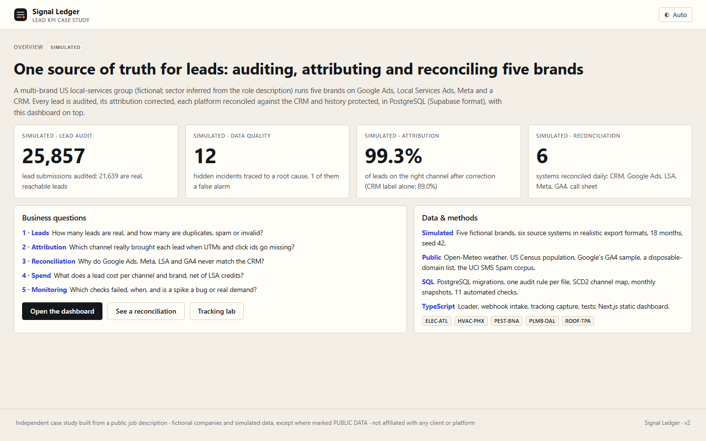
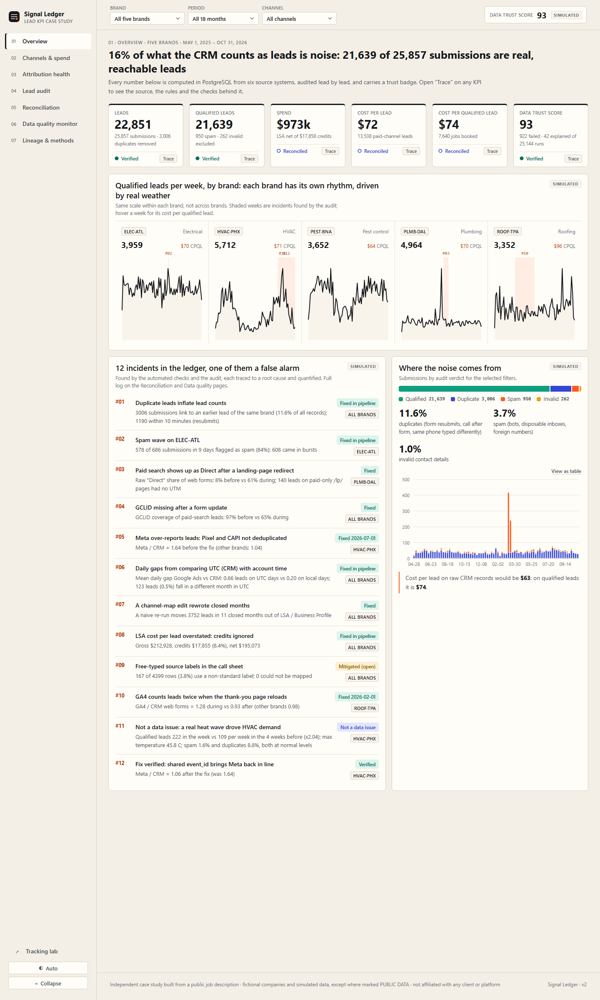
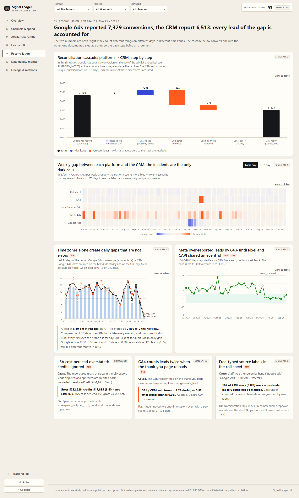
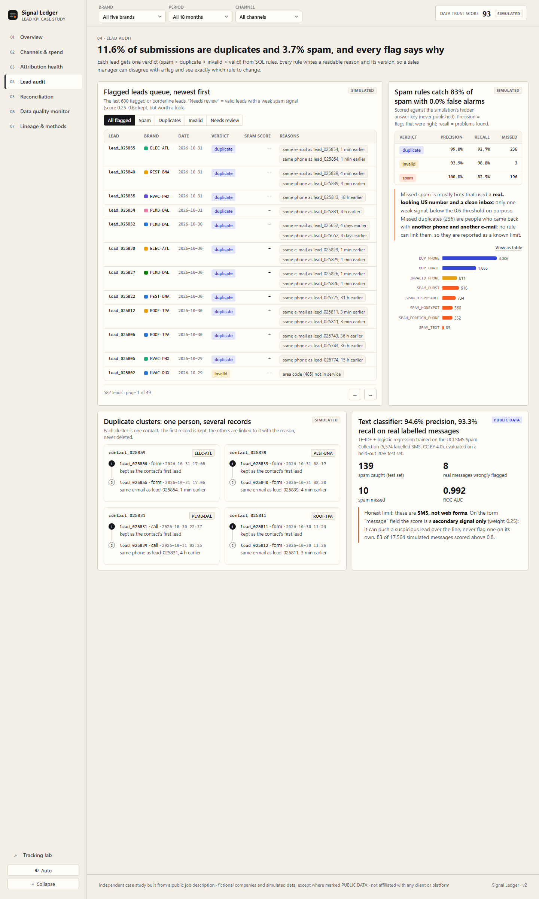
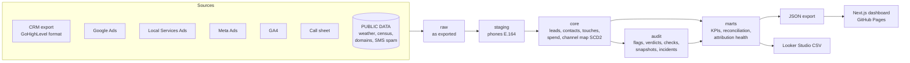

# One source of truth for leads

**Auditing, attributing and reconciling lead data across five local-service brands.**



**Live dashboard:** https://albt-france.github.io/multi-brand-lead-kpi-case-study/ · **PDF report (8 pages):** [report/lead-kpi-case-study.pdf](report/lead-kpi-case-study.pdf) · **Tracking lab:** [/lab](https://albt-france.github.io/multi-brand-lead-kpi-case-study/lab/)

A multi-brand US local-services group (fictional; the sector is inferred from the role description: several businesses in one dashboard, Google Local Services Ads, Google Business Profile, a GoHighLevel-style CRM) runs five brands on Google Ads, Local Services Ads (LSA), Meta and a CRM. Leads, attribution and ad spend never agree between systems. This project rebuilds the whole chain in PostgreSQL (Supabase-ready) and proves every number:

- **every lead audited**: duplicate, spam or invalid, with a readable reason and the rule version;
- **attribution corrected**: raw CRM channel → corrected channel, with the rule that decided;
- **six systems reconciled** every day: CRM, Google Ads, LSA, Meta, GA4 and a hand-typed call sheet;
- **history protected**: a mapping change never rewrites a closed month (SCD type 2 + snapshots);
- **12 hidden incidents** found, explained and quantified, including **one false alarm** that must *not* be "fixed".

> All company data is **SIMULATED** (fictional brands, simulated platform exports in realistic formats). Real **PUBLIC DATA** is used where marked: Open-Meteo weather, US Census population, Google's GA4 sample, a public disposable-domain list and the UCI SMS Spam Collection. No real platform API is called.

## What this demonstrates

| Block of the brief | Where it is in this project |
|---|---|
| **1. Dashboards & reporting**: multi-brand KPIs, cost per lead, discrepancies, automated reports and checks | Next.js dashboard ([Overview](https://albt-france.github.io/multi-brand-lead-kpi-case-study/dashboard/)), `marts.kpi_daily_brand`, 11 automated checks (`db/transforms/60_checks.sql`), Data Trust Score, a "Trace" lineage drawer on every KPI |
| **2. Lead auditing & attribution**: duplicates, spam, invalid; UTM / GCLID; reconciliation CRM / platforms / sheets; exact history | `db/audit/*.sql` (one rule per file, readable reasons), attribution priority rules (`50_attribution.sql`), reconciliation cascade (`marts.recon_cascade`), `core.channel_map_scd2` + `audit.kpi_snapshots` |
| **3. Databases**: SQL, Supabase / PostgreSQL, pipelines, integrity, documentation, backups | Migrations in Supabase format (`db/migrations`: `raw`, `staging`, `core`, `audit`, `marts` schemas, RLS example), run and tested in a real PostgreSQL 18 (PGlite), integrity assertions, generated [data dictionary](docs/DATA_DICTIONARY.md), [data flow](docs/DATA_FLOW.md), dated CSV backups (`npm run backup`) |
| **4. Tracking & integrations**: GTM, GA4, Google Ads, Stape / server-side GTM, Meta Pixel + CAPI | [Tracking plan](docs/TRACKING_PLAN.md), [server-side design](docs/SERVER_SIDE_TRACKING.md), capture snippet with a shared `event_id` and once-only conversion (`integrations/tracking-lab`, tested, live [/lab](https://albt-france.github.io/multi-brand-lead-kpi-case-study/lab/)), checks for GCLID capture, Pixel/CAPI deduplication, GA4 double counting; real GA4 sample analysed (PUBLIC DATA) |
| **5. Automation & AI**: APIs, webhooks, Zapier, audits, cleaning, automated reports; tested code | Webhook intake in Supabase Edge Function format (`integrations/webhook-intake`, idempotent), Google Apps Script daily sheet audit (`apps_script/`), [3 automation designs](docs/AUTOMATIONS.md), [runbook](docs/RUNBOOK.md), text spam classifier evaluated on a real held-out set, Vitest + pytest + SQL tests, CI that rebuilds everything from public sources |
| **Skills**: SQL, Supabase/PostgreSQL, JavaScript/TypeScript, Apps Script, Next.js, GitHub, Looker Studio | SQL first (CTEs, window functions, `DISTINCT ON`, `jsonb`, recursive CTE, RLS); TypeScript loader, intake and tests; Next.js static export on GitHub Pages; [Looker Studio](docs/LOOKER_STUDIO.md) CSV + recipe |

## Three screens

| Overview | Reconciliation | Lead audit |
|---|---|---|
|  |  |  |

Seven pages: Overview, Channels & spend, Attribution health, Lead audit, Reconciliation, Data quality monitor, Lineage & methods. Dark mode and every page: `docs/screens/`. Written deliverables: [audit report](docs/AUDIT_REPORT.md), [reconciliation method](docs/RECONCILIATION_METHOD.md), [KPI definitions](docs/KPI_DEFINITIONS.md), [platform notes](docs/PLATFORM_NOTES.md).

## Key results (SIMULATED data, scored against the simulation's hidden answer key)

| | Result |
|---|---|
| Submissions audited | 25,857 → 21,639 qualified leads (11.6% duplicates, 3.7% spam, 1.0% invalid) |
| Duplicate rule | precision 99.8%, recall 92.7% (missed: people who came back with another phone *and* another e-mail) |
| Spam rules | precision 100.0%, recall 82.9% (missed: bots with a single weak signal, below the threshold on purpose) |
| Attribution | right channel for 99.3% of leads after correction vs 89.0% from the CRM label alone |
| Reconciliation | Google Ads 7,329 conversions → CRM report 6,513 qualified leads, every step measured |
| False alarm | HVAC·PHX lead spike ×2.04 during the real hottest week of summer 2026 in Phoenix: real demand, left uncorrected |

## Architecture



- **Python** (`pipeline/`): public data download, simulation (seed 42), spam classifier, GA4 panel.
- **PostgreSQL** (`db/`): migrations, transforms, one audit rule per file, tests. Runs locally in **PGlite** (PostgreSQL compiled to WebAssembly, no install, no Docker); deployable as-is to Supabase.
- **TypeScript** (`scripts/`, `lib/`, `integrations/`): database build, phone normalization (libphonenumber), webhook intake, tracking capture, evaluation, export, docs, backup, screenshots, PDF.
- **Apps Script** (`apps_script/`): daily audit of a leads Google Sheet; its logic is tested with Vitest (not run in a live Sheet).
- **Dashboard** (`web/`): Next.js static export + ECharts, report-style layout (Segoe UI / Inter, same palette in light and dark), keyboard and screen-reader friendly (every chart has a table view), a printable `/report` route for the PDF.

## How to rerun

```bash
pip install -r requirements.txt
python pipeline/fetch_public.py          # public data, once (add --ga4 for the GA4 sample, ~1.8 GB streamed)
python pipeline/simulate.py              # the five fictional brands, seed 42
python pipeline/spam_classifier.py       # train + evaluate on SMS Spam, score form messages
npm ci
npm run db:build                         # migrations + raw load + core (PGlite, data/pgdata)
npm run audit                            # audit rules, checks, snapshots, incident log, evaluation
npm test                                 # Vitest: SQL integrity, history, RLS, webhook intake, tracking capture, Apps Script logic
pytest -q tests                          # Python: privacy and pipeline checks
npm run export                           # JSON for the dashboard, Looker Studio CSV, AUDIT_REPORT + DATA_DICTIONARY
npm run backup                           # dated CSV backup of core and audit tables
npm run dev                              # http://localhost:3000
npm run build                            # static site in web/out (copies the tracking lab)
npm run pdf                              # report/lead-kpi-case-study.pdf (headless Edge)
npm run screens                          # screenshots in docs/screens
```

## Sources and licences

| Source | Use | Licence |
|---|---|---|
| [Open-Meteo Archive API](https://open-meteo.com/) | daily weather of the five cities, drives demand | CC BY 4.0 |
| [US Census Bureau, county population estimates 2025](https://www2.census.gov/programs-surveys/popest/datasets/2020-2025/counties/totals/) | market size | Public domain |
| [disposable-email-domains](https://github.com/disposable-email-domains/disposable-email-domains) | spam rule | CC0 1.0 |
| [UCI SMS Spam Collection](https://archive.ics.uci.edu/dataset/228/sms+spam+collection) | text classifier training and evaluation | CC BY 4.0 |
| Google GA4 obfuscated sample (Google Merchandise Store), via the Hugging Face mirror `gizdevans/ga4-bq-flattened-data` | real attribution-health panel | Google public sample data; mirror MIT |
| next, echarts, @electric-sql/pglite, libphonenumber-js, Inter | code and font | MIT, Apache-2.0, OFL |

Data retrieved on 2026-11-18.

## Limits

- Company data, platforms and incidents are simulated: the value is in the method, not in the numbers.
- Platform rules are taken from official documentation where it could be read, and labelled *modelled* otherwise ([docs/PLATFORM_NOTES.md](docs/PLATFORM_NOTES.md)); nothing here was run against a live Google Ads, Meta, LSA, GoHighLevel or Stape account.
- Phone numbers are fictional (555-0100–0199 lines across US area codes), so area codes do not reflect geography.
- The text classifier is trained on SMS, not web forms; it is only a secondary signal.

## Methods

AI-assisted workflow: I used Claude, mainly to write scripts faster. I drove the project: I defined the questions, chose and validated the data sources, made the analytical decisions and checked every result.

---

Independent case study built from a public job description · fictional companies and simulated data, except where marked PUBLIC DATA · not affiliated with any client or platform
