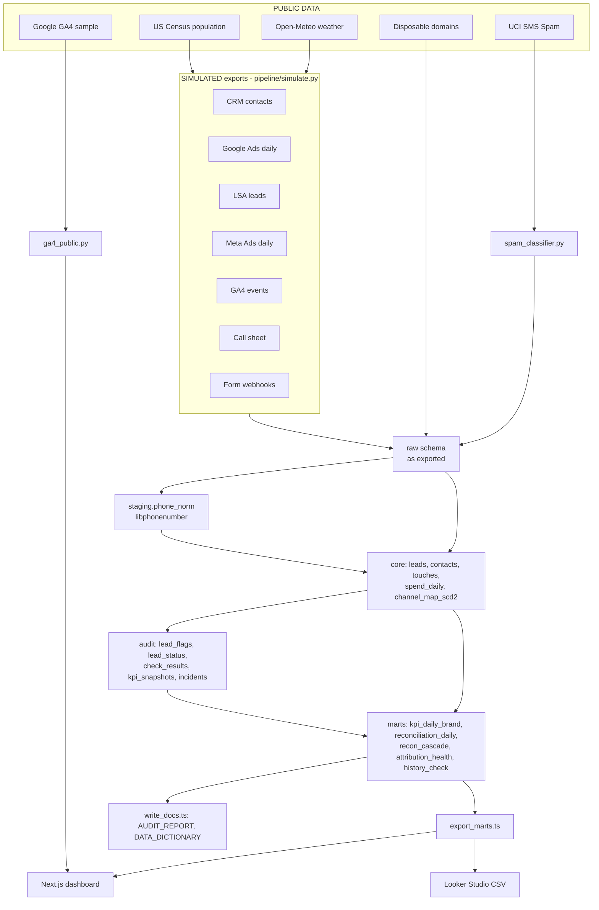

# Data flow

| Step | Command | Code |
|---|---|---|
| Public data | `python pipeline/fetch_public.py` | pipeline/fetch_public.py |
| Simulation | `python pipeline/simulate.py` | pipeline/simulate.py |
| Classifier | `python pipeline/spam_classifier.py` | pipeline/spam_classifier.py |
| Database | `npm run db:build` | db/migrations, scripts/db_build.ts, db/transforms/10_core.sql |
| Audit | `npm run audit` | db/audit/*.sql, db/transforms/60-80_*.sql, scripts/evaluate.ts |
| Export | `npm run export` | scripts/export_marts.ts, scripts/write_docs.ts |
| Backup | `npm run backup` | scripts/backup.ts → backups/YYYY-MM-DD/ |
