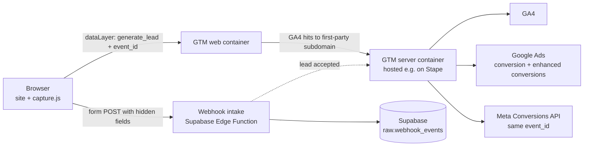

# Server-side tracking design

*Design document; no live container. Stape is named as a possible host for the server container, not as a tested service.*

## Why a server container
A server container runs on a server you control, receives requests from the browser and processes them with tags, triggers and variables (Google's server-side tagging introduction, read 2026-11-18). It lets the business:
- send the conversion from the server **after** the CRM accepted the lead (fewer spam conversions reported to the ad platforms);
- enrich the server event with hashed first-party data;
- serve tracking from a first-party subdomain.

## Deduplication
The same `event_id` travels: browser → hidden field → webhook → server event. The Meta Pixel event and the Conversions API event share `event_id` and `event_name`, so Meta keeps one (within 48 hours).

## Control points (what to check, where)

| # | Point | Check |
|---|---|---|
| 1 | Landing | UTM / gclid present in storage after a redirect (lab step 1) |
| 2 | Form | hidden fields filled (lab step 2); CHK01 GCLID coverage ≥ 80% |
| 3 | dataLayer | one `generate_lead` per submission (lab step 3); CHK04 GA4 / CRM 0.80–1.08 |
| 4 | Webhook | `raw.webhook_events` row with the same event_id; duplicate deliveries stored once |
| 5 | Server container | preview mode shows the incoming GA4 request and the outgoing Meta / Google requests with the same event_id |
| 6 | Platforms | CHK03 Meta / CRM 0.75–1.30; CHK05 Google Ads / CRM 0.85–1.15 |
